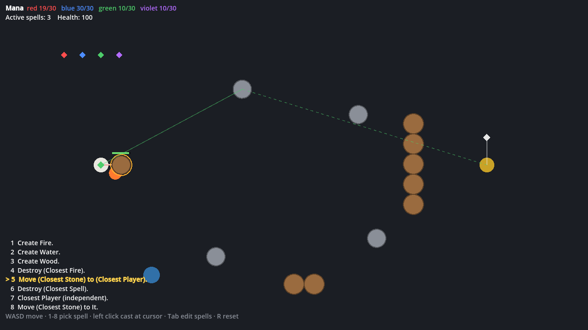

# Spellcraft Prototype

A Godot 4 prototype of a game where players invent their own magic: spells are
sentences built from snap-together blocks, like Scratch. See
[docs/game-design.md](docs/game-design.md) for the full design.

This is **Prototype 1**. It aims to show that three verbs, four materials and one
selector are enough to build spells that interact in ways nobody scripted.



## Running it

1. Install [Godot 4.5](https://godotengine.org/download) (standard build, GDScript only).
2. Open `project.godot` in Godot and press **F5**, or run
   `godot --path .` from this folder.

| Input | Action |
| --- | --- |
| WASD / arrows | Move |
| 1–9, 0 | Cast that slot's spell toward the mouse |
| Enter | Type a spell to cast (see below) |
| Tab | Open or close the spellbook (pauses the simulation) |
| Left click | While picking This or There, pick |
| Esc | Cancel a cast that is waiting for picks, or close the typing bar |
| Space | Drop one of your attached spells (pick it in a window) |
| R | Reset the sandbox |

### Making spells fast

**Type them.** Press **Enter**, type the spell, press **Enter** again: it's
cast toward the mouse. Words can be cut to any prefix that fits where they
stand, so `mo cl st to me` is `Move (Closest Stone) to Me`; a thing on its
own means the closest one (`move stone me`, `destroy fire`); parentheses,
commas, "of", "to" and "m" are optional, plurals are fine (`destroy all fires
within 3 of there, up to 2`), and a noun on its own holds it (`closest player`).
While the typed spell reads, the world rings what it would act on right now,
and a line says how much, or that it would wait.
While you type, up to five words that could come next are suggested (**Tab**
takes the first) and the spell is shown as it's understood, colored by the
mana each word costs, with its cost. **Ctrl+1–0** saves it to that slot
instead; **↑/↓** recall spells typed before.

**Or click them.** **Tab** opens the spellbook: your ten slots on the left,
the chosen one on the right, where you can type it the same way or click its
words. Each word opens a menu of at most five choices (longer lists are split
into submenus: Pick ▸ Closest, Farthest, Random, All), "+" adds optional parts
(adjectives, "within", "up to", "at"), and optional parts have Remove.

For now the player has **infinite mana**: casting never takes from storage,
but each spell still gets its usual fuel and reserve. To turn it off, remove
the `infinite_mana` tag in `scripts/sandbox.gd`. Then walk over the colored
diamonds to collect mana.

## What's in Prototype 1

| Block family | In the prototype |
| --- | --- |
| Verbs | Create, Destroy, Move, Mark, Hold *(a noun on its own)*, Alternate [*slot or attached spell*] [*slot or attached spell*] |
| Create's objects | Fire, Water, Wood, Stone, or Spell [*another spell*]; optionally *at (noun)*: right in front of it, then the closest free spots around |
| Qualifiers | Thing *(any physical object)*, Fire, Water, Wood, Stone, Spell, Player, Mana |
| Pickers | Closest, Farthest, Random, All |
| Adjectives | Moving, Burning, Mine, Theirs, Marked |
| Picked when casting | Chosen *(an attached spell)*, This *(click an object)*, There *(click a place)* |
| Other nouns | Me, Here *(the spell's location)*, Aimed, It *(inside an Alternate)* |
| Adverbs | up to N *(1, 2, 3 or 5)* |
| Relations | Target of, Caster of, Maker of, Products of |

The preset slots (keys 1–9 and 0):

| Slot | Spell | Name |
| --- | --- | --- |
| 1 | Create Fire. | |
| 2 | Alternate [spell 5] [spell 6]. | Juggle |
| 3 | Create Wood. | Barrier |
| 4 | Destroy (Closest Fire). | Extinguish |
| 5 | Move (Closest Stone) to Me. | Pull |
| 6 | Move (Closest Stone) to (Closest Player). | Boulder throw |
| 7 + 8 | Hold (Closest Player), then Move (Closest Stone) to (Target of Chosen). | Live tracker |
| 9 | Create Spell [Destroy (Closest Fire)]. | Fire warden |
| 0 | Move This to There. | Telekinesis |

To try the live tracker, cast 7, then 8 and pick the held selector in the
window. The stone chases whichever other player is closest to you, switching
targets as you move.

### Nouns

A noun says what a spell acts on. Spells read like sentences:
`Move (All Moving Stone within 3 m of There) to Me`.

- **Pickers** choose by distance: **Closest**, **Farthest**, **Random** or
  **All** of a qualifier, narrowed by any number of **adjectives** (Moving,
  Burning, Mine = made by your spells, Theirs = someone else's, Marked = by
  your Mark). Distance is measured from the spell, or **to** another noun
  (`Closest Stone to There`), and can be limited **within** 1–5 m (of the
  spell, or of a noun). A spell attached to you never picks you. Inside a
  spell a picker chooses once, at cast; a held one (Hold) chooses again
  every tick, and Random sticks with its pick while it still fits.
- **Picked when casting:** **This** (click an object), **There** (click a
  spot; it becomes an invisible place marker for as long as the spell lasts)
  and **Chosen** (pick one of your attached spells in a window). Each use is
  picked separately, in reading order; the game keeps running while you pick,
  and Esc cancels the cast.
- **Aimed** is the first object along the line from the spell toward where
  you cast it. **Me** is you. **Here** is the spell's own location: where you
  are for a spell you cast, or where a created spell sits, so
  `Create Wood at Here` or `(All Fire within 2 m of Here)`.
- **Relations** are re-read every tick: **Target of** a spell is what it acts
  on now (a held noun's value, a Create's newest product, what a Move or
  Destroy acts on); **Caster of** is who cast it; **Maker of** an object is
  the spell that created it; **Products of** a Create is everything it made.
  They nest: `(Target of (Target of Chosen))`.
- **It**, inside an Alternate, is what the *other* spell acted on in its last
  turn; each of the two spells has its own It. Outside an Alternate it means
  nothing.

Acting on several targets (All, Products of) drains the spell's mana once per
target per tick.

### Adverbs

Any spell, nested ones included, can take an adverb from the adverb picker
at the end of its sentence. The first is **up to N**, which sets how much:

| Verb | Up to N |
| --- | --- |
| Create | makes at most N objects, then only sustains them |
| Create Spell | makes N spells instead of 3 (and carries mana for N) |
| Destroy | acts on the N nearest at a time; ends once it has destroyed N |
| Move | moves only the N nearest |
| Mark | marks at most N, then ends |
| Hold | holds at most N picks |
| Alternate | runs N turns, then ends |

It reads as `Destroy (All Fire), up to 2.` and, like any word, costs mana.

### Hold, inventory and Chosen

Casting a noun on its own (**Hold**, e.g. `Hold (Closest Player)`) doesn't do
anything by itself: it stays attached to you and keeps re-reading its noun
while its mana lasts. Every spell attached to you is in your **inventory**,
listed top right, and **Chosen** lets another spell use one:
`Destroy Chosen` dispels it, and `Move (Closest Stone) to (Target of Chosen)`
follows what a held selector picks now. Several spells can use the same held
noun.

**Space** drops one of your attached spells, picked in a window while the
game keeps running: it stays where it is, stops following you, and leaves
your inventory. Since it's no longer attached to you, its pickers can pick
you, and its Here is where you dropped it. A Move whose destination is another spell's target keeps chasing: it
doesn't end when it arrives or is blocked, and slides around obstacles.

### Mark

**Mark** *noun* marks what the noun means, for you: the adjective **Marked**
then picks it, as in `Destroy (All Marked Thing)`. It's done once it has
marked something, unless it follows a spell's target, in which case it marks
each new one.

### Alternate

**Alternate** [*A*] [*B*] runs two spells attached to itself, one at a time,
switching when the running one is done, or after 3 s if it isn't. Each side
is either:

- **a spell slot** (`spell 5`): the spell in that slot is copied in when you
  cast, and cast fresh each turn, paid for by the Alternate. A slot that
  leads back to the Alternate itself is rejected.
- **an attached spell** (**Chosen**, picked when casting): the Alternate takes
  it over. It leaves your inventory, runs only on its turns (paused, using no
  mana, in between), keeps paying its own way, and ends with the Alternate.

If one side has nothing left to run, the other keeps going; the Alternate
ends when its mana runs out, or after its "up to" turns. Inside it, **It** is
what the other side acted on in its last turn. The Juggle preset (slot 2) is
`Alternate [spell 5] [spell 6]`: pull the closest stone to you, throw the
closest stone at the closest player, and again.

### Spells wait for a target

A spell with nothing to act on doesn't end: it waits, still draining mana,
and looks again every tick for anything its nouns can mean. `Destroy
(Closest Fire)` cast with no fire around destroys the next fire that appears.
A spell still ends when it reaches its goal (what a Destroy locked onto is
gone), when a spell it follows is destroyed (it's cut off), or when its mana
runs out. A Move whose object or destination is destroyed looks for another,
and a Destroy following a selector goes on to the selector's next pick.

### Spells that create spells

Choose **Spell** as Create's object to describe the spell to create (in the
spellbook, a nested sentence opens in brackets). Spells nest: the created spell
can itself be a Create Spell.

- **Create Spell makes 3 spells**, one at once and then one a second, then
  ends. Like Create, it puts each in the closest free spot to where it aims,
  refilling the spot of a spell that ended.
- **The creator carries the mana up front.** Casting a spell that creates
  others takes, besides its own fuel, a *reserve* of one *share* per spell it
  will make. A share is enough to run that spell for 60 s, plus that spell's
  own reserve, and so on down, so nesting multiplies the cost (3 x 3 spells
  for a Create Spell inside a Create Spell). If storage can't cover the
  reserve, the cast fails; with ordinary storage (30 per color) that rules
  most Create Spells out, so they're really for the infinite-mana sandbox.
- **A created spell is paid from its creator's reserve**, one share each,
  never from the caster's storage. It keeps what it must carry for its own
  created spells as its reserve and burns the rest.
- **A created spell sits where it was made** and doesn't follow the caster.
  Me still means the caster, Target of the creator means the newest spell
  it made, and Products of means all of them.
- Each spell drains only its own words. A spell that ends returns fuel and
  any unspent reserve to the world.
- There is no word limit; cost (drain plus reserve) is what keeps spells in check.

### Rules

Interaction rules: fire sets flammable things burning, and burning wood is
destroyed. Water destroys fire and puts out burning things. Anything moving
stops at stone. When two solid objects collide, each takes damage
once, from the other's mass times the speed they closed at, if that's high
enough: a thrown stone hurts a player (and a little itself), a player walking
into a wall hurts nothing, and something pressed against you hits only when
it first arrives. Moves
add up: several Moves on one object combine their pushes (opposite ones
cancel), and a Move on a player adds to their walking. A spell
that touches mana absorbs it into its own fuel, so `Move (Closest Mana) to It`
can top up a running spell.

## How it's built

```
scripts/
  sim/             deterministic simulation; never draws
    simulation.gd    fixed 20 Hz tick, collisions, casting, mana release
    world_object.gd  the single object type; kinds differ only by properties
    materials.gd     property presets for materials, players, mana, spells
    rules.gd         contact rules written against properties
  spells/
    spell_grammar.gd spells as data: blocks, words, mana colors, validation
    spell.gd         a cast spell: performs its verb every tick until it ends
  render/world_view.gd   draws simulation state, smoothed between ticks
  spells/spell_parser.gd  reads typed spells; suggests the next word
  ui/hud.gd, ui/spell_editor.gd (the spellbook), ui/spell_chips.gd (clickable
  words), ui/spell_input.gd + ui/quick_cast.gd (typing), ui/spell_text.gd
  sandbox.gd       test arena and preset spells
  main.gd          runs the tick loop and turns local input into commands
tests/test_spells.gd   headless tests for every prototype spell and rule
```

The design calls for a server-authoritative multiplayer game, so the
simulation is kept apart from everything else. It takes input only as
command dictionaries, validates every cast (grammar, mana), and
is deterministic for a given seed and inputs. Networking can be added later
without changing it.

Run the tests with:

```
godot --headless --path . --script res://tests/test_spells.gd
```

## Decisions made for the prototype

These are open questions in the design doc. The prototype picks a simple
answer for each so it can be playtested. Every value can be tuned through the
constants at the top of each script.

- **Create places its object in front of the caster**, toward the cursor, so it needs no Where.
- **Create keeps creating until its mana runs out.** Each new object goes in the free spot closest to where Create aims: just in front of you toward where you cast, or with *at*, right in front of what it's at (on it, for There). Spots are tried outward from there, your side first, so objects gather around that point, and a gap (an object destroyed or pushed away) is refilled first. With no free spot within reach (6 object widths), Create waits. While the spell lasts it sustains everything it made, so fire doesn't burn out. Building takes about 1.5 s for wood and 1 s for fire. Created objects stay after the spell ends, though fire then burns out after 10 s.
- **Mana storage is a limit per color** (30), and players start full. A cast infuses at most 10 of each color it needs.
- **Every block drains 0.2 mana per second** of its color, so a typical spell runs for 25–50 s. Colors follow the design doc's first sketch, and Wood, Me, It and Mana have colors assigned here.
- **Mana can be selected and moved but not created.** Create Mana would produce mana for less than it yields.
- **Mana crystals regrow:** one random crystal appears every 3 s, up to 12 in the world.
- **Picks are stored in the spell.** What you click for This and There, and pick for Chosen, is written into the cast spell, so the server can check it: Chosen must be one of your attached spells, This an existing object, There inside the arena.
- **Spells are edited in the spellbook while the game is paused, or typed while it runs.** The word menus only offer words that fit the grammar.
- **Objects are circles.** There are no boxes or height layers yet.
